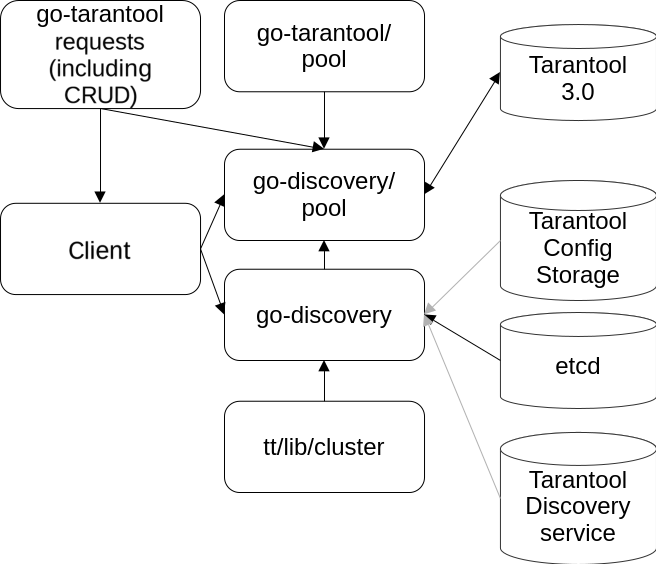

# Cluster discovery Go library

## Table of contents

- [Summary](#summary)
- [Alternatives considered](#alternatives-considered)
- [Core library (`go-discovery`)](#core-library-go-discovery)
  - [Node configuration provided by the library](#node-configuration-provided-by-the-library)
  - [Helper types for filtering nodes](#helper-types-for-filtering-nodes)
  - [Basic functionality for retrieving the node list](#basic-functionality-for-retrieving-the-node-list)
  - [Subscribing and receiving updates when the configuration changes](#subscribing-and-receiving-updates-when-the-configuration-changes)
- [(Sub)library for a connection pool with autodiscovery (`go-discovery/pool`)](#sublibrary-for-a-connection-pool-with-autodiscovery-go-discoverypool)
  - [Code example](#code-example-2)

## Summary

**In brief**

We need to be able to retrieve the current list of nodes that match a set of
criteria (tags, role, RW/RO) from the Tarantool cluster configuration store,
watch for updates, and create a connection pool based on some criteria so that
we can send requests to it.

**Main points**

- We are building a separate library based on the `go-tarantool` connector.
- The library consists of the core discovery functionality in `go-discovery`.
- The library includes a connection pool built on that core functionality in
  the separate `go-discovery/pool` subpackage.
- We are taking a similar approach for other programming languages and connectors.
- This is implemented only for etcd. We assume that the entire cluster
  configuration is stored and updated there.
- Support for Tarantool Config Storage and Tarantool will be implemented later,
  if at all. We need to take this into account in the design.

The diagram below shows how this fits together.



**A few explanations**

- `go-discovery` is based on our two libraries, `go-tarantool/pool` and
  `tt/lib/cluster`.
- Clients can use `go-discovery` directly or build a connection pool on top of
  it with `go-discovery/pool`.
- All types of requests from `go-tarantool` can be sent to the connection pool,
  including requests from `go-tarantool/crud`.
- We currently support only etcd as a configuration source. Tarantool Config
  Storage and some service from Tarantool may be supported in the future
  (this has yet to be implemented).

## Alternatives considered

We settled on a separate library that can be used in Go. For other connectors or
languages, a similar library with a similar API will be developed if needed.
That is why I tried to avoid anything Go-specific in the API.

We could have taken other approaches.

### Create a separate service for autodiscovery

It looks like this would be better implemented on top of Tarantool. Each node,
or each node with a specific role, would know whether the other nodes are
available. This seems to be planned for the future.

A separate Go microservice would require more work and is outside the current
plans. It could be built on this library later.

### Implement the functionality in the `go-tarantool` connector

There are several arguments against this approach.

1. The proposed functionality is **EE**, the closed-source part. The
   `go-tarantool` connector is currently open source. Technically, this means
   the functionality cannot be made part of the connector.
2. We would like to keep the connector relatively small. First, this avoids
   pulling in unnecessary dependencies. Second, it makes the connector easier
   to maintain, release, and so on, independently of other modules.

## Core library (`go-discovery`)

### Node configuration provided by the library

We need to identify the minimum information that the library will provide
about a node and make it the most useful information for the task.

#### `Mode`

An auxiliary enum type used to set the `master` or `replica` operating mode
for a node.

```go
// Mode is the operating mode of a node.
type Mode int
const (
	// ModeAll is the mode where it does not matter whether the node is a master
	// or a replica. In configuration, it means the node can be either.
	ModeAll Mode = iota
	// ModeRW means the node can be written to and read from.
	ModeRW
	// ModeRO means the node can only be read from.
	ModeRO
)
```

#### `Instance`

The configuration of an individual node. It is worth noting that separate
tags cannot currently be set for individual nodes (this will be implemented
later). There are currently two places to put tags.

1. [roles_cfg.tags](https://github.com/tarantool/tarantool/blob/f58bfc97c627f1838696697339fb3e443c05767a/src/box/lua/config/instance_config.lua#L2194-L2197)
2. [app.cfg.tags](https://github.com/tarantool/tarantool/blob/f58bfc97c627f1838696697339fb3e443c05767a/src/box/lua/config/instance_config.lua#L1637-L1643)

This will be expanded in the future.

```go
// Instance describes the configuration of an individual node.
type Instance struct {
	// Group is the name of the node's current group.
	Group      string
	// Replicaset is the name of the node's current replica set.
	Replicaset string
	// Name is the name of the node.
	Name       string
	// Mode is the node's operating mode, rw/ro.
	Mode       Mode
	// URI is the list of URIs for connecting to the node.
	URI        []string
	// Roles is the list of roles for the node.
	Roles      []string
	// RoleTags is the list of role tags for the node. It can be configured as a
	// set of strings in roles_cfg.tags.
	//
	// [https://github.com/tarantool/tarantool/blob/f58bfc97c627f1838696697339fb3e443c05767a/src/box/lua/config/instance_config.lua#L2194-L2197](https://github.com/tarantool/tarantool/blob/f58bfc97c627f1838696697339fb3e443c05767a/src/box/lua/config/instance_config.lua#L2194-L2197)
	RoleTags   []string
	// AppTags is the list of application tags. It can be configured as a set of
	// strings in app.cfg.tags.
	//
	// [https://github.com/tarantool/tarantool/blob/f58bfc97c627f1838696697339fb3e443c05767a/src/box/lua/config/instance_config.lua#L1637-L1643](https://github.com/tarantool/tarantool/blob/f58bfc97c627f1838696697339fb3e443c05767a/src/box/lua/config/instance_config.lua#L1637-L1643)
	AppTags    []string
	// Tags is the list of tags for the node.
	// Tarantool currently does not support tags for individual nodes. This will
	// be implemented later, at which point this functionality can be added.
	// Tags       []string
}
```

### Helper types for filtering nodes

The task requires us to filter nodes by some conditions. These conditions
are based on the configuration of an individual node. I defined a common
interface and types for basic filters on individual fields. The list can be
extended in the library or in client code if desired.

#### `Filter`

`Filter` is the basic interface for filtering a node by some conditions.

```go
type Filter interface {
	// Filter returns true if the instance matches the criteria.
	Filter(instance Instance) bool
}
```

#### `GroupsFilter`

`GroupsFilter` keeps only nodes in groups with the specified names.

```go
type GroupsFilter struct {
	// Groups lists the group names to match.
	Groups []string
}

// The other filters also implement Filter. I omitted the methods for brevity.
func (f GroupsFilter) Filter(instance Instance) bool {
	// ...
}
```

#### `ReplicasetsFilter`

`ReplicasetsFilter` keeps only nodes in replica sets with the specified names.

```go
type ReplicasetsFilter struct {
	// Replicasets lists the replica set names to match.
	Replicasets []string
}
```

#### `NamesFilter`

`NamesFilter` keeps only nodes with the specified names.

```go
type NamesFilter struct {
	// Names is the list of node names to filter by.
	Names []string
}
```

#### `ModeFilter`

`ModeFilter` keeps only nodes in the specified operating modes.

```go
type ModeFilter struct {
	// Mode lists the operating modes to match.
	Mode []Mode
}
```

#### `URIFilter`

`URIFilter` keeps only nodes with the specified URIs.

```go
type URIFilter struct {
	// URI lists the URIs to match.
	URI []string
}
```

#### `RolesFilter`

`RolesFilter` keeps only nodes with the specified roles.

```go
type RolesFilter struct {
	// Roles lists the roles to match.
	Roles []string
}
```

#### `RoleTagsFilter`

`RoleTagsFilter` keeps only nodes with the specified role tags.

```go
type RoleTagsFilter struct {
	// RoleTags lists the role tags to match.
	RoleTags []string
}
```

#### `AppTagsFilter`

`AppTagsFilter` keeps only nodes with the specified application tags.

```go
type AppTagsFilter struct {
	// AppTags lists the application tags to match.
	AppTags []string
}
```

#### Future

`TagsFilter` keeps only nodes with the specified tags.

Tarantool currently does not support tags for individual nodes. This will be
implemented later, at which point this functionality can be added.

```go
//type TagsFilter struct {
//	// Tags lists the tags to match.
//	Tags []string
//}
```

### Basic functionality for retrieving the node list

We need to be able to retrieve a list of node configurations from etcd, filter
it by some criteria, and find out which nodes are available for connection.
This section describes the types that provide this functionality.

This may be extended to Tarantool Config Storage and Tarantool in the future.

#### `Discoverer`

The basic interface for retrieving the node list.

```go
// Discoverer is the interface that implements the Discovery method for
// retrieving node configurations.
type Discoverer interface {
	// Discovery returns the list of node configurations current at the time of
	// the call.
	Discovery(ctx context.Context) ([]Instances, error)
}
```

#### `EtcdDiscoverer`

For now, we need a concrete implementation of this interface that retrieves
the list of node configurations from etcd.

```go
// EtcdDiscoverer retrieves the list of node configurations from etcd.
type EtcdDiscoverer struct {
	// client is the etcd connection object from the etcd library.
	// https://pkg.go.dev/go.etcd.io/etcd/client
	// The library user configures the connection to etcd.
	client *clientv3.Client
	// prefix is the key prefix under which etcd stores the Tarantool
	// configuration.
	prefix string
}

// NewEtcdDiscoverer creates a new object for retrieving the node list from etcd.
func NewEtcdDiscoverer(client *clientv3.Client, prefix string) *EtcdDiscoverer {
	// ...
}

// Discovery returns the list of node configurations retrieved from etcd.
func (d *EtcdDiscoverer) Discovery(ctx context.Context) ([]Instances, error) {
	// ...
}
```

#### `FilterDiscoverer`

It would also be useful to filter the node list at this level. Filtering it
in advance would reduce the work in later stages where possible.

```go
// FilterDiscoverer filters the node list by some criteria.
type FilterDiscoverer struct {
	// discoverer is the underlying implementation of Discoverer. The result of
	// its Discovery() call is filtered.
	discoverer Discoverer
	filters    []Filter
}

// NewFilterDiscoverer creates a new Discoverer that filters the incoming
// node list according to the supplied filters.
func NewFilterDiscoverer(discoverer Discoverer,
	filters ...Filter) *FilterDiscoverer {
	// ...
}

// Discovery calls d.discoverer.Discovery() and returns the filtered node list.
func (d *FilterDiscoverer) Discovery(ctx context.Context) ([]Instances, error) {
	// ...
}
```

#### `ConnectableDiscoverer`

From the client's point of view, it would also be useful to retrieve a list of
nodes that are currently available for connection. We can introduce another
type for this.

```go
// ConnectableDiscoverer returns the list of nodes available for connection.
type ConnectableDiscoverer struct {
	// factory helps create a Dialer to establish a connection to an instance.
	factory DialerFactory
	// discoverer is the underlying implementation of Discoverer. The result of
	// its Discovery() call is filtered by whether the nodes can be connected to.
	discoverer Discoverer
}

// NewConnectableDiscoverer returns a new ConnectableDiscoverer for retrieving
// the list of nodes available for connection.
func NewConnectableDiscoverer(factory DialerFactory, discoverer Discoverer) *ConnectableDiscoverer {
	// ...
}

// Discovery calls d.discoverer.Discovery() and returns the list of nodes
// available for connection.
func (d *ConnectableDiscoverer) Discovery(ctx context.Context) ([]instances, error) {
	// ...
}
```

#### Code example

The following client code shows how to retrieve a list of nodes that are
available for connection and have been filtered by some criteria.

```go
// The client code configures its own connection to etcd.
etcdcli := client.New(client.Config{
	Endpoints: []string{"http://127.0.0.1:2379"},
})
defer etcdcli.Close()

discoverer := NewConnectableDiscoverer(
	NewFilterDiscoverer(
		NewEtcdDiscoverer(etcdcli, "/prefix"),
		RolesFilter{[]string{"vshard", "config"}},
		NamesFilter{[]string{"instance-001", "instance-002"}},
		ModeFilter{ModeRW}
	)
)
isnstances, err := discoverer.Discovery(ctx)
if err != nil {
	return err
}
```

#### Future

In the future, we can add `TcsDiscoverer` and `TarantoolDiscoverer` to retrieve
the current node list from TCS (Tarantool Config Storage) and Tarantool,
respectively (this functionality would have to be added to Tarantool).

### Subscribing and receiving updates when the configuration changes

We also need to be able to keep the node list up to date. This requires
additional types for subscribing to updates.

#### `Event`

The only event type. We could split it into several types, but one seems
to be enough.

```go
// Event is the basic structure for an event that updates the node list.
type Event struct {
	// Old is the old node configuration. It may be absent if the node is new.
	Old Instance
	// HasOld indicates whether the old configuration is present.
	HasOld bool
	// New is the new node configuration. It may be absent if the node was
	// removed.
	New Instance
	// HasNew indicates whether the new configuration is present.
	HasNew bool
}
```

#### `Observer`

We also need an interface that the event receiver will implement.

```go
// Observer is the interface for receiving new events.
type Observer interface {
	// Observe receives new events or an error. After an error, no further
	// events will arrive.
	Observe(events []Event, err error)
}
```

#### `Scheduler`

We need to retrieve the configuration periodically. This is another
interface for that purpose.

```go
// Scheduler is the interface for triggering updates according to a schedule.
type Scheduler interface {
	// Wait allows waiting until the next event occurs.
	Wait(ctx context.Context) error
	// Stop stops periodic event generation.
	Stop()
}
```

#### `PeriodicScheduler`

A concrete implementation that allows the configuration to be updated at
regular intervals.

```go
// PeriodicScheduler generates an update event at a fixed interval.
type PeriodicScheduler struct {
	period time.Duration
}

// NewPeriodicScheduler returns a new PeriodicScheduler object.
func NewPeriodicScheduler(period time.Duration) *PeriodicScheduler {
	// ...
}

// Wait blocks until the next interval elapses.
func (s *PeriodicScheduler) Wait(ctx context.Context) error {
	// ...
}

// Stop stops periodic event generation.
func (s *PeriodicScheduler) Stop() {
	// ...
}
```

#### `EtcdWatchScheduler`

etcd lets us subscribe to updates under a prefix. This means we can create
events when keys under that prefix change.

```go
// EtcdWatchScheduler generates an update event when the configuration under a
// prefix changes in etcd.
type EtcdWatchScheduler struct {
	// client is the etcd connection object from the etcd library.
	// https://pkg.go.dev/go.etcd.io/etcd/client
	// The library user configures the connection to etcd.
	client *clientv3.Client
	// prefix is the key prefix under which etcd stores the Tarantool
	// configuration.
	prefix string
}

// NewEtcdWatchScheduler returns a new EtcdWatchScheduler object.
func NewEtcdWatchScheduler(client *clientv3.Client,
	prefix string) *EtcdWatchScheduler {
	// ...
}

// Wait blocks until the configuration changes in etcd.
func (s *EtcdWatchScheduler) Wait(ctx context.Context) error {
	// ...
}

// Stop stops watching the prefix and generating events.
func (s *EtcdWatchScheduler) Stop() {
	// ...
}
```

#### Future

In the future, we could implement `TcsWatchSubscriber` and
`TarantoolWatchSubscriber` to watch for updates in Tarantool Config Storage
and Tarantool, respectively.

#### `Subscriber`

We also need an interface that concrete types providing subscriptions to
updates will implement.

```go
// Subscriber is the interface for types that provide updates to the current
// node list.
type Subscriber interface {
	// Subscribe lets you subscribe to updates.
	Subscribe(observer Observer) error
	// Unsubscribe lets you stop receiving updates.
	Unsubscribe(observer Observer)
}
```

#### `ScheduleSubscriber`

`ScheduleSubscriber` retrieves the node list from a `Discoverer` on the
`Scheduler`'s schedule, compares it with the current list, and sends updates
to the subscriber.

```go
// ScheduleSubscriber combines a Scheduler and a Discoverer. It retrieves the
// node list from the Discoverer on the specified schedule and sends updates
// to the subscriber.
type ScheduleSubscriber struct {
	scheduler  Scheduler
	discoverer Discoverer
}

// NewScheduleSubscriber creates a new SchedulerSubscriber object for
// retrieving the current node list.
func NewScheduleSubscriber(scheduler Scheduler,
	discoverer Discoverer) ScheduleSubscriber {
	// ...
}

// Subscribe lets you subscribe to updates.
func (s *ScheduleSubscriber) Subscribe(observer Observer) error {
	// ...
}

// Unsubscribe lets you stop receiving updates.
func (s *ScheduleSubscriber) Unsubscribe(observer Observer) {
	// ...
}
```

#### `FilterSubscriber`

We also need to be able to filter the event list.

```go
// FilterSubscriber filters the event stream from the underlying Subscriber
// and picks out only nodes with matching configurations.
type FilterSubscriber struct {
	subscriber Subscriber
	filters    []Filter
}

// NewFilterSubscriber creates a new object for filtering the event list.
func NewFilterSubscriber(subscriber Subscriber,
	filters ...Filter) (*FilterSubscriber, error) {
	// ...
}

// Subscribe allows subscribing to filtered updates.
func (s *FilterSubscriber) Subscribe(observer Observer) error {
	// ...
}

// Unsubscribe lets you stop receiving updates.
func (s *FilterSubscriber) Unsubscribe(observer Observer) {
	// ...
}
```

#### `ConnectableSubscriber`

We also need to be able to receive information about events only for connected
nodes and generate additional events when they disconnect.

```go
// ConnectableSubscriber filters the event stream from the underlying
// Subscriber and picks out only nodes available for connection. It also
// generates additional events when a node disconnects.
type ConnectableSubscriber struct {
	subscriber Subscriber
}

// Subscribe allows subscribing to updates on whether nodes are available for
// connection.
func (s *ConnectableSubscriber) Subscribe(observer Observer) error {
	// ...
}

// Unsubscribe lets you stop receiving updates.
func (s *ConnectableSubscriber) Unsubscribe(observer Observer) {
	// ...
}
```

#### Code example

This example shows how to update the list of nodes from etcd that are
available for connection and have been filtered by some criteria.

```go
// Implement Observer in client code.
type someObserver struct {
	wg sync.WaitGroup
}

func (o someObserver) Observe(events []Event, err error) {
	if err != nil {
		fmt.Printf("error: %s", err)
		wg.Done()
	}
	for event, _ := range events {
		switch{
		case event.HasNew && !event.HasOld:
			fmt.Printf("instance added: %q", event.New)
		case !event.HasNew && event.HasOld:
			fmt.Printf("instance removed: %q", event.Old)
		case event.HasNew && event.HasOld:
			fmt.Printf("instance updated, old: %q, new: %q", event.Old, event.New)
		}
	}
}

// Create the etcd client in client code.
etcdcli := client.New(client.Config{
	Endpoints: []string{"[http://127.0.0.1:2379](http://127.0.0.1:2379/)"},
})
defer etcdcli.Close()

// Create a Discoverer that uses etcd and some filters.
discoverer := NewFilterDiscoverer(
	NewEtcdDiscoverer(etcdcli, "/prefix"),
	RolesFilter{[]string{"vshard", "config"}},
	NamesFilter{[]string{"instance-001", "instance-002"}},
	ModeFilter{ModeRW}
)

// Create a scheduler that watches etcd keys under the given prefix.
scheduler := NewEtcdWatchScheduler(etcdcli, "/prefix")
defer scheduler.Stop()

// Create a Subscriber that receives updates from etcd, filters the nodes by
// some criteria, and returns only nodes that are available for connection.
subscriber := NewConnectableSubscriber(
	NewFilterSubscriber(
		NewScheduleSubscriber(scheduler, discoverer),
		AppTagsFilter{[]string{"app-1", "app-2"}}
	)
)

// Create our own someObserver object.
var observer someObserver.
observer.wg.Add(1)

// Subscribe to updates.
subscriber.Subscribe(observer)
defer subscriber.Unsubscribe(observer)

// Wait for the first error, then exit.
observer.wg.Wait()
```

## (Sub)library for a connection pool with autodiscovery (`go-discovery/pool`)

The core library can be used to improve the existing `go-tarantool/pool`
connection pool. It is a relatively simple connection pool that can add new
connections, remove connections that are no longer needed, and monitor the
availability of individual connections. In general, this is what we need.

We can build a smarter connection pool with autodiscovery on top of it.

### `DialerFactory`

An auxiliary type that creates a `tarantool.Dialer` object for a specific
connection. It is needed so that different connection parameters can be set
for different nodes.

```go
type DialerFactory interface {
	NewDialer(instance Instance) (tarantool.Dialer, error)
}
```

### `NetDialerFactory`

The basic implementation of the factory does not use TLS. It can be extended
with other implementations if desired, for example to support TLS or set
different parameters for different nodes.

```go
// NetDialerFactory creates objects for establishing network connections to a
// given node.
type NetDialerFactory struct {
	// Username is the username used to connect.
	Username string
	// Password is the password used to connect.
	Password string
}

// NewDialer creates a new tarantool.Dialer object for the given node.
func (f NetDialerFactory) NewDialer(instance Instance) (tarantool.Dialer, error) {
	// ...
}
```

### `Balancer`

Users would like to have different request-balancing strategies. For this, we
need to define a basic balancer interface.

**Important.** *It is hard to say at this point which interface and
implementation will be efficient in practice. We will need to run benchmarks
and may need to change the interface. The overall goal is to support unusual
cases like the one below.*

> There is another way to look at this. Round-robin is possible with priority
> as well. We have six instances in total, three in one data center and three
> in another. I want to send requests to any instance in turn, giving
> preference to the ones in my data center. I would only send requests to the
> other data center if none are available in mine.

*In other words, even if the interface changes, this requirement must still
be met. For example, this can currently be done using `PriorityBalancer`.*

```go
// Balancer is the interface that a request balancer must implement. It
// selects the next node for a request.
type Balancer interface {
	// Add adds the node to the balancer's active list.
	Add(instance Instance)
	// Remove removes the node from the balancer's active list.
	Remove(instance name)
	// Next returns the name of the next active node to send a request to.
	// The second return value is true if there is a next node.
	Next(mode Mode) (string, bool)
}
```

### `RoundRobinBalancer`

The simplest balancer we can offer sends requests to all nodes in turn. It
is thread-safe.

```go
// RoundRobinBalancer sends requests to all nodes in turn.
type RoundRobinBalancer struct {
}

// NewRoundRobinBalancer creates a round-robin balancer.
func NewRoundRobinBalancer() *RoundRobinBalancer {
	// ..
}

// Add adds the node to the balancer's active list.
func (b *RoundRobinBalancer) Add(instance Instance) {
	// ..
}

// Remove removes the node from the balancer's active list.
func (b *RoundRobinBalancer) Remove(name string) {
	// ..
}

// Next returns the next node for executing the request. It selects the next
// node in turn from all nodes in the specified mode.
func (b *RoundRobinBalancer) Next(mode Mode) (string, bool) {
	// ..
}
```

### `PriorityBalancer`

A balancer with priorities. Requests are executed on the highest-priority
nodes. If nodes have the same priority, requests are executed on them in
round-robin order.

```go
// PriorityBalancer allows requests to be executed only on a specific node or
// group of nodes assigned the highest priority.
type PriorityBalancer struct {
	// ..
}

// NewPriorityBalancer creates a balancer based on a function that determines
// a node's priority weight.
func NewPriorityBalancer(priorityFunc func(instance Instance) int) *PriorityBalancer {
	// ..
}

// Add adds the node to the balancer's active list.
func (b *PriorityBalancer) Add(instance Instance) {
	// ..
}

// Remove removes the node from the balancer's active list.
func (b *PriorityBalancer) Remove(name string) {
	// ..
}

// Next returns the next node for executing the request. It selects the next
// node in turn from all nodes in the specified mode.
func (b *PriorityBalancer) Next(mode Mode) (string, bool) {
	// ..
}
```

### `Pool`

A connection pool with autodiscovery. It uses a `Subscriber` from the core
library to subscribe to changes. The options for connecting to nodes are set
when the connection pool is created.

```go
// Pool is a connection pool that monitors availability and executes requests
// only on available nodes in round-robin order.
type Pool struct {
	// The implementation is built on the go-tarantool connection pool.
	pool       tarantoolpool.Pool
	subscriber Subscriber
	balancer   Balancer
	factory    DialerFactory
	opts       tarantool.Opts
}

// NewPool returns a new Pool object. It subscribes to connection updates
// from the Subscriber, uses the given balancer to send requests, and connects
// to nodes with the given options.
func NewPool(subscriber Subscriber, balancer Balancer,
	factory DialerFactory, opts tarantool.Opts) (Pool, error) {
	// ...
}

// Do executes a request asynchronously. It works the same way as the
// Connection and Pool methods in go-tarantool. It uses requests from
// go-tarantool, so all of them can be reused.
func (p *Pool) Do(request tarantool.Request) (*tarantool.Future) {
	// ...
}

// DoMode executes a request asynchronously on nodes in the specified
// operating mode (rw/ro/all). We need this method because etcd does not
// always store information about a node's current operating mode. For the
// off and manual settings of replication.failover, that information is
// stored. For election and supervised, information about the current
// operating mode is available only from box.info.ro after connecting to
// the node.
//
// This means we cannot generally filter all nodes by operating mode in
// advance. That is only possible for off or manual failover, so Pool must
// also query nodes with an unknown operating mode and read box.info.ro.
func (p *Pool) DoMode(request tarantool.Request, mode Mode) (*tarantool.Future) {
	// ...
}

// Close shuts down the connection pool.
func (p *Pool) Close() {
	// ...
}
```

### `ModePool`

An adapter that turns a regular `Pool` into an object implementing
`tarantool.Doer` for the selected node operating mode. This avoids creating
separate pools for `rw` and `ro` nodes, which would be inefficient. We would
need two pools and therefore have to query twice as many nodes with
`election` or `supervised` failover. With `off` or `manual` failover, we can
do this using filters without extra overhead.

```go
type ModePool struct {
	// pool is the underlying connection pool.
	pool *Pool
	// mode is the selected operating mode.
	mode Mode
}

// NewModePool returns a new object with the specified connection pool and mode.
func NewModePool(pool *Pool, mode Mode) *ModePool {
	// ..
}

// Do executes a request using the selected node operating mode for the pool.
func Do(request tarantool.Request) (*tarantool.Future) {
	return pool.DoMode(pool, mode)
}
```

### Code example

```go
// Create an etcd client with some parameters.
etcdcli := client.New(client.Config{
	Endpoints: []string{"[http://127.0.0.1:2379](http://127.0.0.1:2379/)"},
})
defer etcdcli.Close()

// Create a Discoverer that uses etcd and some filters.
discoverer := NewFilterDiscoverer(
	NewEtcdDiscoverer(etcdcli, "/prefix"),
	RolesFilter{[]string{"vshard", "config"}},
	NamesFilter{[]string{"instance-001", "instance-002"}},
	ModeFilter{ModeRW}
)

// Create a Scheduler that reacts to updates to keys in etcd.
scheduler := NewEtcdWatchScheduler(etcdcli, "/prefix")
defer scheduler.Stop()

// Create a Subscriber that receives updates from etcd and filters nodes by
// some criteria. This filtering and the preceding filtering determine which
// nodes the pool actually uses.
subscriber := NewConnectableSubscriber(
	NewFilterSubscriber(
		NewScheduleSubscriber(scheduler, discoverer),
		AppTagsFilter{[]string{"app-1", "app-2"}}
	)
)

// Create a balancer that gives preference to nodes in certain data centers.
balancer := NewPriorityBalancer(func(instance Instance) int {
	switch instance.Group {
	case "datacenter-1":
		return 20
	case "datacenter-2":
		return 10
	default:
		return 0
	}
})

// Create a new connection pool. Connect as the guest user with a timeout of
// five seconds per request.
factory := NetDialerFactory{
	Username: "guest",
}
pool, _ := NewPool(subscriber, balancer,
	factory, tarantool.Opts{Timeout: 5*time.Second})
defer pool.Close()

// Create an object for conveniently sending requests to RW nodes.
rwpool := NewModePool(pool, ModeRW)
// Create an object for conveniently sending requests to RO nodes.
ropool := NewModePool(pool, ModeRO)

// Execute a go-tarantool request on RW nodes. It would be executed the same
// way in go-tarantool.Connection.
data, err := rwpool.Do(tarantool.NewSelectRequest("foo").Key([]any{"bar"}).Get()
fmt.Println(data)
fmt.Println(err)

// Execute a go-tarantool request on RO nodes. It would be executed the same
// way in go-tarantool.Connection.
data, err := ropool.Do(tarantool.NewSelectRequest("foo").Key([]any{"bar"}).Get()
fmt.Println(data)
fmt.Println(err)
```
